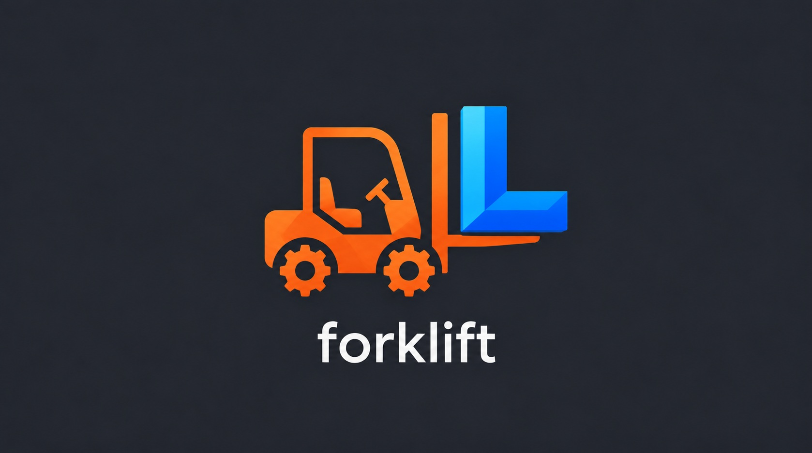

# Identidade visual do Lift e do Forklift

O logo Lift e o ícone Lift em PNG apresentam a identidade nova. O logo
`forklift.jpg` mostra a empilhadeira levantando o L azul do Lift.

- `lift-logo.png` identifica a linguagem e o compilador Lift.
- `forklift.jpg` identifica o Forklift, ferramenta de pacotes e dependências
  do Lift.
- `../../editors/vscode/icon.png` é o ícone quadrado da extensão VS Code.

Consulte a [documentação do Lift](../../README.pt-BR.md) para o estado da
linguagem e o [guia da extensão VS Code](../../editors/vscode/README.pt-BR.md)
para configurar o editor.
