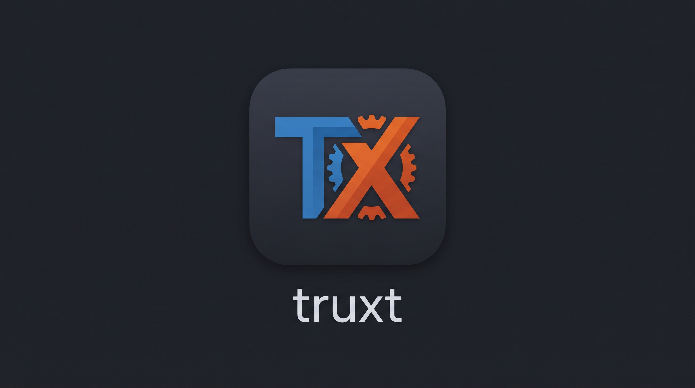

# Identidade visual do Truxt e do Forklift

Estas imagens são os logos do projeto fornecidos pelo mantenedor. Os arquivos
`.jpg` preservam os dados de imagem JPEG/JFIF enviados; não foram recoloridos ou
retocados.

- `truxt.jpg` identifica a linguagem e o compilador Truxt.
- `forklift.jpg` identifica o Forklift, ferramenta de pacotes e dependências
  do Truxt.
- `../../editors/vscode/icon.jpg` é a cópia empacotada como ícone da extensão VS Code.

Consulte a [documentação do Truxt](../../README.pt-BR.md) para o estado da
linguagem e o [guia da extensão VS Code](../../editors/vscode/README.pt-BR.md)
para configurar o editor.
